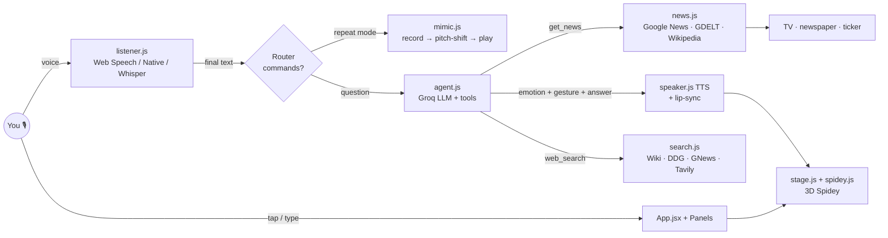

# 🕷️ SPIDEY 3D — Talk · Repeat · Type · News
### A Talking-Tom-style 3D Spider-Man that talks back, copies your voice, writes comic replies and reads the world news like a retro TV anchor.

> Built with **React + Three.js** (3D web app, runs on PC and phones and installs with its own icon) and **Flutter** (native Android / iOS / Windows app that wraps the same 3D scene with native voice).
> Uses free **Gen-AI + Agentic AI**: Groq LLMs with tool calling, RAG (BM25), Whisper speech-to-text, browser/native text-to-speech, live news for every country.
> 🔒 **Nothing is stored.** Keys, voice, questions and answers live in memory only and vanish when you close the app.

---

## 0. TL;DR — get it running in 10 minutes

| You want… | Do this |
|---|---|
| **Run on your PC now** | Install Node.js (nodejs.org, LTS). Double-click **`spidey-app\START-SPIDEY.bat`**. Your browser opens at `http://localhost:4173`. Tap **TAP TO START** and allow the microphone. |
| **Spidey icon on the desktop** | Right-click **`spidey-app\Create-Desktop-Icon.ps1`** → *Run with PowerShell*. Or, inside the running app in Edge/Chrome, click the **Install app** icon in the address bar. |
| **Use it on your phone (free, https)** | Run `npm run build` in `spidey-app`, then drag the **`dist`** folder onto **https://app.netlify.com/drop**. Open the link on your phone → browser menu → **Add to Home screen**. You get an app icon. |
| **Native Android APK / Windows .exe** | Follow `spidey_flutter\README.md` (section 6 below). |
| **Make Spidey smart (free)** | Get a free key at **https://console.groq.com/keys**, then open **SETUP ⚙️** in the app and paste it. |

⚠️ **On the Shell office network**, `api.groq.com` is blocked (a GenAI category block) and HTTPS is inspected. Without Groq the app still works with its *offline brain* (Wikipedia + DuckDuckGo + live news). For full AI, use your home Wi-Fi or a phone hotspot.

---

## 1. What's in the box (folders & files)

```
Srilu POC\
├── DOCUMENTATION.md            ← this file
├── spidey-app\                 ← REACT + THREE.JS app (the main product)
│   ├── START-SPIDEY.bat        ← double-click: install, build, open the app
│   ├── Create-Desktop-Icon.ps1 ← puts a "Spidey 3D" icon on your desktop
│   ├── package.json            ← dependencies (react, three, vite)
│   ├── vite.config.js          ← dev/preview server + /gnews proxy (fixes CORS)
│   ├── index.html              ← page shell, fonts, PWA manifest link
│   ├── .env.example            ← optional: build your own keys in (personal use only)
│   ├── public\
│   │   ├── manifest.webmanifest ← makes it an installable app (name, icons, colours)
│   │   ├── sw.js               ← service worker: caches ONLY app files, never data
│   │   ├── _redirects          ← Netlify proxy for Google News (free hosting works out of the box)
│   │   ├── icons\              ← generated 3D app icons (png + spidey.ico for Windows)
│   │   └── img\spidey-hero.webp← your Spidey photo, used on the splash screen
│   ├── worker\worker.js        ← OPTIONAL Cloudflare proxy (only for non-Netlify hosting)
│   └── src\
│       ├── main.jsx            ← React entry point
│       ├── App.jsx             ← THE BRAIN OF THE UI: modes, mic, agent, news bulletin, pokes
│       ├── styles.css          ← Talking-Tom glossy icons, comic bubble, retro news graphics
│       ├── scene\              ← 3D
│       │   ├── stage.js        ← renderer, retro studio room, lights, bloom + colour grade, camera, TV, newspaper
│       │   ├── spidey.js       ← the rigged 3D Spider-Man (skeleton, suit, blazer, eyes, mouth)
│       │   ├── gestures.js     ← poses, 30 gestures, emotions → eye shapes & body language
│       │   └── textures.js     ← procedural textures: web suit, mask, tweed, skyline, neon, poster…
│       ├── voice\
│       │   ├── listener.js     ← ALWAYS-ON mic: Web Speech / Flutter native / Groq Whisper
│       │   ├── speaker.js      ← text-to-speech + lip-sync levels
│       │   ├── mimic.js        ← Talking-Tom repeat (record → pitch-shift → play back)
│       │   ├── mic.js          ← shared microphone + level meter
│       │   └── bridge.js       ← JavaScript ⇄ Flutter bridge
│       ├── ai\
│       │   ├── groq.js         ← Groq API client (auto-detects available models)
│       │   ├── agent.js        ← AGENTIC AI: tool-calling loop + RAG fallback + offline brain + bulletin writer
│       │   ├── search.js       ← free web search (Wikipedia, DuckDuckGo, Google News; optional Tavily/Groq Compound)
│       │   ├── rag.js          ← BM25 retriever (the "R" in RAG)
│       │   └── emotion.js      ← emotion detector (sad news → sad Spidey)
│       ├── news\news.js        ← news engine: 44 countries, topics, live/today/week/past/upcoming
│       └── ui\
│           ├── Icons.jsx       ← hand-drawn SVG icons for the tiles
│           └── Panels.jsx      ← splash, settings, actions menu, country picker, news bar, ticker, comic bubble
└── spidey_flutter\             ← FLUTTER native shell (Android / iOS / Windows)
    ├── pubspec.yaml            ← packages + asset folders + launcher icon config
    ├── lib\main.dart           ← WebView + native STT/TTS/fetch bridge
    ├── android_overrides\AndroidManifest.xml ← mic & internet permissions
    ├── copy_web.ps1            ← copies the built React app into Flutter assets
    └── README.md               ← step-by-step Flutter guide
```

The old files in the root (`all code.txt`, `Services.txt`, `a.webp`…) are your previous version. They're kept untouched for reference.

---

## 2. Features (what you asked for → where it is)

| Request | How it's done | File |
|---|---|---|
| Full-screen Spidey, full body, PC & phone | Camera auto-fits the whole body to any screen shape (portrait phone or wide PC) | `stage.js → framing()` |
| **3D, not 2D** | A real-time 3D rigged character: 17 joints, 10 finger joints per hand, eyes and mouth | `spidey.js` |
| Suit like a retro newsreader | Tweed / navy / tuxedo blazer with lapels, bow tie, collar, pocket square. **SUIT** icon cycles outfits | `spidey.js → OUTFITS` |
| Talking-Tom interface & polished icons | Glossy 3D tiles with white rims, bevels, glow when active, labels | `styles.css .tile`, `Icons.jsx` |
| Small mode icons that activate on click | Left dock: **TALK · REPEAT · TYPE · NEWS** | `App.jsx MODES` |
| Mic ON automatically, small icon to turn it OFF | Mic starts as soon as the app opens. The green **MIC** tile has a live level ring; tap it to turn the mic off or on | `App.jsx micStart/toggleMic` |
| 1) Repeat what I say | **REPEAT** mode: records you and plays it back in a funny high voice (Talking Tom). Optional "Spidey's voice" style | `mimic.js` |
| 2) Answer by **voice** with movement and gestures | **TALK** mode: no chat window. Spidey thinks (hand to chin), answers aloud, the mouth lip-syncs, and he gestures with an emotion that fits | `App.jsx answer()/sayIt()` |
| 3) Answer as **unique text** | **TYPE** mode: comic "SPIDEY SAYS!" bubble with typewriter font and an optional read-aloud button | `Panels.jsx ComicBubble` |
| Newsreader in a chair reading the newspaper | **NEWS** mode: the desk and chair rise, Spidey sits, holds *The Daily Web*, flips pages, looks up to present | `stage.js`, `gestures.js READ/DESK/pageflip` |
| TV in the background shows things | Retro CRT TV and an over-the-shoulder news screen show the live headline, mood, country, waveform while listening, and a spinner while searching | `stage.js drawTV()` |
| Reacts to news (sad → sorrow) | Every story gets a mood (from the LLM or the lexicon) → eye shape + body language (sad head-drop, clap, surprise…) | `emotion.js`, `EMOTE` |
| Every country, past / present / "future" news | 44 countries + World; LIVE (last hour), TODAY, WEEK, **PAST** (any date since ~2015), **UPCOMING** (scheduled events) | `news.js` |
| News every minute | Auto-refresh every 60 s; genuinely new stories are announced as **⚡ BREAKING** | `App.jsx useEffect` |
| Indian news errors fixed | Default country is India and uses the official India edition of Google News, with a GDELT fallback (`sourcecountry:india`) | `news.js` |
| Answer every question | Agentic AI with web search, news, Wikipedia and history tools, plus an offline brain if there's no key | `agent.js` |
| Nothing stored | No database or logs. Settings are kept only if you tick "Remember". "Forget everything now" button | `App.jsx`, `sw.js` |
| App with an icon | PWA install (PC & phone), desktop shortcut with `.ico`, Flutter APK/EXE with launcher icon | `manifest`, `Create-Desktop-Icon.ps1`, `pubspec.yaml` |
| Poke Spidey like Tom | Tap head → "Ouch!", tap belly → tickle-laugh, hands → high five, feet → hop | `App.jsx POKES` |
| Fun actions | Wave, back-flip, shoot web (THWIP! splat), dance, jump, hero pose, bow, shrug, facepalm, joke | `Panels.jsx FUN_LIST` |

### Voice commands (say them any time)
"**news**" / "**read the news**" · "**India sports news**" · "**news from Japan**" · "**next**" / "**skip**" · "**stop**" · "**repeat mode**" · "**type mode**" · "**talk mode**" · "**do a flip**" · "**dance**" · "**shoot a web**" · "**change your suit**" · "**turn off the mic**". Anything else is treated as a question.

---

## 3. Step-by-step setup (FREE)

### 3.1 PC (Windows) — run it
1. Install **Node.js LTS** from https://nodejs.org (Next → Next → Finish).
2. Open the folder `Srilu POC\spidey-app` and double-click **`START-SPIDEY.bat`**.
   - The first time it runs `npm install` (about 1 minute), then builds and opens `http://localhost:4173`.
3. Click **TAP TO START** (browsers only allow sound and the mic after one tap). Allow the microphone when asked.
4. Say "Hello Spidey!" 🎉

*Developer mode (live reload while you edit code):* open a terminal in `spidey-app` and run `npm install`, then `npm run dev` → http://localhost:5173.

### 3.2 PC — app icon on the desktop
- **Option A (recommended):** with the app open in **Edge** or **Chrome**, click the *Install* icon (⊕) in the address bar → **Install**. Windows adds "Spidey 3D" with the 3D icon to the Start menu and desktop, and it opens in its own window like a real app.
- **Option B:** right-click `Create-Desktop-Icon.ps1` → *Run with PowerShell*. It creates a "Spidey 3D" desktop shortcut with `spidey.ico` that runs `START-SPIDEY.bat`.

### 3.3 Phone (Android / iPhone) — free hosting
1. In `spidey-app` run `npm run build` (or let `START-SPIDEY.bat` do it). This creates the **`dist`** folder.
2. Go to **https://app.netlify.com/drop** and drag the `dist` folder onto the page. You get a free `https://….netlify.app` link.
   - `dist\_redirects` tells Netlify to proxy Google News, so world news works with no extra setup.
3. Open the link on your phone in **Chrome** (Android) or **Safari** (iPhone) → menu → **Add to Home screen**.
4. Open Spidey from the home screen, tap START, and allow the mic.

> Speech recognition in the browser: Chrome and Edge (PC & Android) have built-in recognition. On iPhone Safari, recognition support varies by iOS version. If it doesn't work, add a Groq key: Spidey then uses **Groq Whisper** automatically, which works in any browser.

### 3.4 Keys (all free)
| Key | Where | What it unlocks | Free limit |
|---|---|---|---|
| **Groq** (recommended) | https://console.groq.com/keys → *Create API Key* | Smart answers (Llama 3.3 70B / GPT-OSS…), tool calling, news scripts, Whisper STT | Generous free tier (rate-limited per minute/day). No card needed |
| **Tavily** (optional) | https://app.tavily.com | Better web search results | 1,000 searches / month |
| None | — | Offline brain: Wikipedia + DuckDuckGo + live news + jokes | Unlimited |

**Why your Gemini key "didn't work properly":** Gemini's free tier has tight per-minute quotas, region restrictions and frequent model renames. Calling it directly from the browser also exposes the key and often hits CORS or quota errors. **Groq** is OpenAI-compatible, very fast, free, and works from the browser, so the app uses it. The app asks Groq which models are currently available (`/models`) and picks the best one automatically, so a retired model name never breaks the app.

**Free "search API" answer:** you don't need a paid search key. Spidey's `web_search` tool combines **Wikipedia API + DuckDuckGo Instant Answers + Google News RSS** (all free, no key). If you add Tavily, or if your Groq account has a `groq/compound` model, those are used too.

---

## 4. How it works (architecture)



### 4.1 The 3D character (`spidey.js`, `gestures.js`, `textures.js`)
- **No model file and no copyright-risky download.** Spidey is built from code: lathe-turned torso and limbs, a sphere mask, finger capsules. Textures are painted on `<canvas>` at start-up (web lines with highlights, bump maps, chest spider emblem, blue side panels, tweed blazer with a V-neck cut-out via `alphaMap`).
- **Mask trick:** the head sphere is rotated so its pole points forward, so the texture's vertical lines become the mask's radiating web spokes and horizontal lines become the rings, exactly like the real mask.
- **Eyes:** each lens is a shape rebuilt every frame and projected onto the curved face. Parameters `scale, top, bot, tilt, curve` create emotions:
  `happy` (smile-eyes), `sad` (outer lids droop, `tilt:+1`), `serious` (`tilt:-0.9`), `surprised` (`scale:1.25`), `thinking` (one eye squints), plus a blink every 2–6 s.
- **Mouth:** a dark opening on the mask grows with speech volume, and the chin vertices drop (jaw) for real lip-sync.
- **Animation system:** base pose (STAND / SIT / READ / DESK) → emotion posture → gesture clip (weights blend in/out) → procedural life (breathing, sway, eye saccades, look-at-mouse, talk head-bob) → smoothing (`damp`, rate 16).
  Rotation conventions: arm forward `-x`, left arm out `+z`, right arm out `-z`, head down `+x`.
- **Gestures (30):** wave, hello, nod, shake, think, listen (hand to ear), cheer, clap, jump, back-flip, sad, surprised, superhero, shrug, point, thwip (shoots a 3D web line plus a screen splat), laugh, tickle, ouch, hop, high-five, 4 talking beats, bow, dance, facepalm, present, page-flip.

### 4.2 The world (`stage.js`)
- Retro studio: wallpaper, wood panelling, a window onto a **procedural city skyline** (day/dusk/night chosen by your clock), velvet curtains, brass rod, a **neon "SPIDEY NEWS 24"** sign, ON-AIR box, *The Daily Web* poster, floor lamp, plant, rug, a teak **CRT TV** with rabbit ears, the news desk with neon plate, chrome mic, banker's lamp, and a tufted leather chair.
- **Colour grading:** ACES tone-mapping → **Unreal Bloom** (neon, TV and lamps glow) → custom grade shader (teal shadows / warm highlights, contrast S-curve, saturation 1.12, vignette, film grain, slight chromatic aberration, red flash for BREAKING).
- Lights: warm key spotlight with shadows, cyan and magenta rim lights (cinematic look), hemisphere fill, practical lamp/TV/window lights, plus a room environment map for glossy reflections on the lenses and chrome.
- **Camera:** fits the full body on any screen (`framing()`), with slight mouse parallax. News mode zooms to the desk.

### 4.3 Voice
- **Always-on mic (`listener.js`):** Web Speech API with `continuous=true` and interim results. It auto-restarts when the browser stops it and **pauses while Spidey talks**, so he never hears himself. Fallbacks: Flutter native STT, or **Groq Whisper** (a voice-activity detector records each sentence → `whisper-large-v3-turbo`).
- **Speaking (`speaker.js`):** speaks sentence by sentence (avoids Chrome's 15-second cut-off). It picks the best male voice for your language (Edge "Natural" voices sound best). `pitch 1.1, rate 1.02` gives a young Peter Parker voice. Word-boundary events plus an envelope drive the mouth.
- **Repeat (`mimic.js`):** an adaptive noise floor, threshold `max(0.018, floor×2.8)`, 0.3 s pre-roll and 0.7 s silence end form the voice-activity detector. The recording is loudness-normalised and played at `playbackRate 1.45`. That is the Talking-Tom chipmunk effect (adjust it in SETUP).

### 4.4 Gen-AI & Agentic AI (`agent.js`)
1. **Persona prompt:** Spidey's character, spoken style (≤70 words, no markdown/emojis/URLs), today's date and time, your country, the headlines currently on the TV, and *"start every reply with `[emotion|gesture]`"*.
2. **Tool calling (agentic loop, max 4 steps):** the LLM decides on its own to call:
   - `get_news(country, topic, query, when, from_date, to_date)` → real headlines (BM25 re-ranked by your keywords);
   - `web_search(query)` → Wikipedia + DuckDuckGo + Google News (+ Tavily / Groq Compound);
   - `wikipedia(query)`; `on_this_day(month, day)` → history.
   Results go back to the model, which then answers. The tags `[sad|shrug]` are parsed by `parseTags()` → eyes + gesture.
3. **RAG fallback (`classicRAG`):** if a model fails at tool calling, Spidey retrieves documents himself (web + news), ranks them with **BM25**, puts the top 6 in the prompt as CONTEXT and asks the LLM to answer *only* from it.
4. **Offline brain (no key):** greetings, time/date, jokes, news headlines and Wikipedia/DuckDuckGo facts, so it never goes silent.
5. **News bulletin writer:** the LLM turns raw headlines into an anchor script in JSON: `{intro, stories:[{say, mood}], outro}` (in your language, e.g. Hindi). Without a key, a template plus the lexicon mood is used.
6. **Model auto-selection (`groq.js`):** preference list `llama-3.3-70b-versatile → openai/gpt-oss-120b → llama-4-maverick/scout → kimi-k2 → gpt-oss-20b → qwen3-32b → llama-3.1-8b-instant`. It keeps only models your account actually has and moves to the next one on 404 (retired) or 429 (rate limit).

**BM25 (the retriever) in one line:**
`score(doc, query) = Σ_words IDF(w) · f(w,doc)·(k1+1) / (f(w,doc) + k1·(1 − b + b·|doc|/avgdl))`, with `k1 = 1.4`, `b = 0.75`, and `IDF = ln(1 + (N − n + 0.5)/(n + 0.5))`. Words that are rare across all documents but frequent in one document score high. It's fast, needs no embeddings and runs fully in memory.

### 4.5 News (`news.js`)
| When | Google News RSS query | GDELT fallback |
|---|---|---|
| LIVE | `<country> when:1h` | `timespan=1h` |
| TODAY | country edition top stories / topic section | `timespan=1d` |
| WEEK | `… when:7d` | `timespan=7d` |
| **PAST** (pick a date) | `<country> news after:YYYY-MM-DD before:YYYY-MM-DD` + Wikipedia *On this day* | `startdatetime/enddatetime` (2017+) |
| **UPCOMING** | `(upcoming OR "will be held" OR scheduled OR "set to" OR "next week") when:7d` | `timespan=7d` |

- English Google News editions are used for IN, US, GB, AU, CA, NZ, IE, ZA, NG, KE, GH, SG, MY, PH, PK, BD, IL, ET, UG. Other countries use a search on the country name.
- Google News blocks direct browser calls (CORS), so the app uses `./gnews/…`, served by the Vite proxy on your PC or by Netlify `_redirects` online. Flutter fetches natively.
- **Honest note on "future news":** nobody can report the future. Spidey reads *scheduled and expected* events and says so.

---

## 5. Settings explained (SETUP ⚙️)

| Setting | Default | Meaning |
|---|---|---|
| Groq API key | empty | Turns on the full AI. Stored in memory only |
| Tavily key | empty | Optional better web search |
| Language | English (India) | Used for both listening and speaking. Hindi, Telugu, Tamil, Kannada, Malayalam, Marathi and Bengali are included |
| Spidey's voice | Auto | Choose any installed voice. On Windows, *Microsoft … Online (Natural)* voices in Edge sound most human |
| Voice pitch / speed | 1.10 / 1.02 | Higher pitch = younger Spidey |
| Repeat style | Talking-Tom | *Talking-Tom* = your own voice pitched up; *Spidey's voice* = he says your words with his voice |
| Repeat pitch | 1.45 | 1.0 = normal, 2.0 = chipmunk |
| Proxy URL | empty | Only if you host somewhere other than Netlify and Google News fails (deploy `worker/worker.js`) |
| Captions | off | You asked for pure voice, so it's off. Turn it on to show small subtitles |
| Remember on this device | off | Off = nothing saved. On = settings saved in this browser only |

---

## 6. Flutter app (native Android / Windows) — `spidey_flutter`

**Why Flutter wraps the React scene:** the 3D Spidey is written once (Three.js). Flutter shows it full-screen in a WebView served from the app's own assets (`InAppLocalhostServer`, port 8642), and adds what WebViews lack: **native speech-to-text, native text-to-speech and CORS-free fetching**.

**Bridge contract** (`src/voice/bridge.js` ⇄ `lib/main.dart`):

| JS calls `callHandler(...)` | Flutter does | Returns |
|---|---|---|
| `capabilities` | checks STT availability | `{stt, tts, fetch, platform}` |
| `config` | reads `--dart-define=GROQ_KEY=…` | `{groqKey, tavilyKey}` |
| `speak {text, lang, rate, pitch}` | flutter_tts; pushes `SpideyNative.onLevel(x)` for the mouth | `true` when finished |
| `stopSpeak` | stops TTS | `true` |
| `listenStart {lang}` / `listenStop` | speech_to_text, continuous with auto-restart | pushes `SpideyNative.onSpeech({text, final})` |
| `fetchText {url}` | `http.get` (no CORS) | body text |

**Build steps (summary — full detail in `spidey_flutter\README.md`):**
1. Install the Flutter SDK + Android Studio, then run `flutter doctor`.
2. `cd spidey-app` → `npm install` → `npm run build`.
3. `cd ..\spidey_flutter` → `flutter create --project-name spidey_flutter --org com.spidey --platforms android,ios,windows .`
4. Copy `android_overrides\AndroidManifest.xml` → `android\app\src\main\AndroidManifest.xml`, and set `minSdk = 24` in `android\app\build.gradle(.kts)`.
5. `powershell -ExecutionPolicy Bypass -File .\copy_web.ps1` (copies the React build into `assets\web`).
6. `flutter pub get` → `dart run flutter_launcher_icons` (uses the 3D Spidey icon).
7. Phone test: `flutter run --dart-define=GROQ_KEY=gsk_xxx`
8. APK: `flutter build apk --release --dart-define=GROQ_KEY=gsk_xxx` → `build\app\outputs\flutter-apk\app-release.apk` → copy to the phone and install.
9. Windows: `flutter build windows --dart-define=GROQ_KEY=gsk_xxx` → `build\windows\x64\runner\Release\spidey_flutter.exe`.

> The Flutter source couldn't be compiled on this laptop (no Flutter SDK installed). It is written against flutter_inappwebview 6.1, speech_to_text 7 and flutter_tts 4. If `flutter run` shows an error, read the message: it's usually a package-version mismatch fixed with `flutter pub upgrade`.

---

## 7. Customise

| Change | Where |
|---|---|
| Add an outfit | `spidey.js → OUTFITS` (`base` colour, `lapel`, `kind: tweed/pinstripe/plain`, `tie`) |
| New gesture | `gestures.js → CLIPS`: `{ dur, eyes, pose: (t,u,seated) => ({ rSh:[x,y,z], … }) }`, then add it to `FUN_LIST` in `Panels.jsx` |
| Emotion → body reaction | `gestures.js → EMOTE` (standing clip, seated clip) |
| Room colours / time of day | `textures.js → wallpaperTex / skylineTex`, `stage.js` lights |
| Glow / grading strength | `stage.js → UnrealBloomPass(…, strength 0.5, radius 0.5, threshold 1.0)` and `GradeShader` uniforms `vign, grain, sat` |
| Add a country | `news.js → COUNTRIES` (`[code, name, flag, googleEdition or null, gdeltName]`) |
| Spidey's personality | `agent.js → persona()` |

---

## 8. Troubleshooting

| Problem | Fix |
|---|---|
| Spidey doesn't hear me | Click 🔒 in the address bar → Microphone → Allow. Use Chrome or Edge. Make sure the MIC tile is green |
| No voice | Unmute the PC. Choose another voice in SETUP. Click "TEST VOICE" |
| "Groq not reachable" | You're on a network that blocks AI sites (e.g. the office). Use home Wi-Fi or a hotspot, and check the key |
| News: "No news found" | Check the internet. If self-hosting (not Netlify), deploy `worker/worker.js` and paste its URL in SETUP → Proxy URL |
| Blank / slow 3D on an old phone | Close other apps. The app already lowers resolution and shadows on mobile |
| Repeat mode repeats noise | Speak closer to the mic. Raise the threshold in `mimic.js` (`0.018` → `0.03`) |

---

## 9. Honest limits & legal
- Spidey is a **stylised 3D figure made in code**, not a film-quality scanned model. That keeps it light, fully animatable (eyes, mouth, fingers) and legally clean.
- Spider-Man is © Marvel. This is a **personal, non-commercial fan project** for learning. Don't publish it on app stores.
- News comes from public feeds (Google News, GDELT, Wikipedia). Spidey reads what the sources say. "Upcoming" means scheduled events, not predictions.
- LLMs can still make mistakes. With tools on, Spidey is instructed to use only retrieved facts and name the source.
